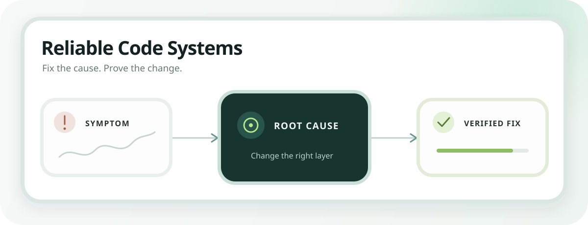
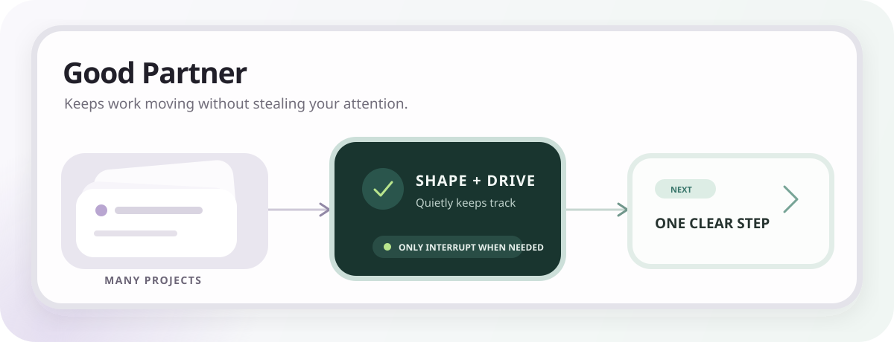

<p align="center">
  
</p>

<p align="center">
  Reusable, inspectable, and verified working contracts for AI agents.
</p>

<p align="center">
  <a href="#english"><kbd><strong> English </strong></kbd></a>
  &nbsp;
  <a href="#中文"><kbd> 中文 </kbd></a>
</p>

---

<a id="english"></a>

# wow-skills

`wow-skills` is a growing collection of reusable skills for software development and knowledge work. It is not a warehouse of oversized prompts. Each skill is a focused working contract with a clear boundary, traceable sources, observable behavior, and a verification loop—so an AI agent can move quickly without becoming a black box.

## Available skills

### [`reliable-code-systems`](skills/reliable-code-systems/SKILL.md)

<p align="center">
  
</p>

Writing code is easy for an AI; knowing the change is correct is the hard part. Reliable Code Systems makes the agent understand how the project works, follow a bug to its real cause, change the right layer, and prove the result with tests and observable evidence. It avoids one-off patches, silent fallbacks, and “looks good” handoffs. Use it when you want code that can be explained, verified, and debugged later—not just code that happens to run once.

**Best for:** feature work, production bugs, architecture changes, data pipelines, background jobs, AI-assisted systems, CI/CD, and reliability reviews.

### [`good-partner`](skills/good-partner/SKILL.md)

<p align="center">
  
</p>

Good Partner helps when work is messy, long-running, or spread across several projects. It turns rough ideas into a clear outcome, keeps one useful next step in front of you, and continues safe work without asking for permission every few minutes. It interrupts only when a real decision, approval, or risk needs your attention. It also remembers where each project stopped and learns your collaboration preferences transparently, so you spend less energy switching contexts, chasing status, and explaining the same thing again.

**Best for:** project shaping, multi-project coordination, approval-heavy workflows, proactive follow-up, durable handoffs, and personalized collaboration.

## Repository structure

```text
skills/<skill-name>/
├── SKILL.md              # Trigger conditions and operating instructions
├── agents/openai.yaml    # Skill metadata for Codex
├── references/           # Detailed knowledge loaded only when needed
└── scripts/              # Deterministic helpers, when useful
```

Shared visual assets live in `assets/`. A skill may omit any optional directory it does not need.

## Quality bar

- Solve a clearly defined and repeatable problem.
- Keep behavior explainable instead of relying on black-box guesses.
- Provide a concrete way to verify whether the skill worked.
- Make scope, authority, state ownership, and failure boundaries explicit.
- Prefer traceable references, small examples, checklists, and executable validation.

## Adding a skill

1. Create `skills/<skill-name>/SKILL.md` with precise trigger conditions.
2. Describe the workflow, boundaries, expected outputs, and verification loop.
3. Add only the references, scripts, or assets that improve repeated execution.
4. Validate the skill and forward-test realistic requests when behavior is complex.
5. Add the skill to both language sections of this README.

## Maintenance principles

- Verify before publishing.
- Clarify boundaries before expanding capabilities.
- Preserve traceability before optimizing for convenience.
- Keep every skill useful in real work, not only impressive in a demo.

<p align="right"><a href="#中文">中文 ↓</a></p>

---

<a id="中文"></a>

# wow-skills · 中文

`wow-skills` 是一个持续积累和验证 Skill 的仓库，主要收纳软件开发与日常知识工作中可重复使用的高质量工作单元。项目目标不是堆叠冗长提示词，而是沉淀边界清晰、来源可追踪、行为可观察、结果可验证的协作契约，让 AI 可以快速执行，同时不变成难以理解的黑盒。

## 当前收录

### [`reliable-code-systems`](skills/reliable-code-systems/SKILL.md)

<p align="center">
  
</p>

AI 写代码不难，难的是确认它真的改对了。这个 Skill 会先读懂项目如何运行，沿着执行链路找到问题的真正原因，再修改应该负责的那层代码，并用测试、日志和实际结果证明修改有效。它避免只修表面、偷偷加兜底或凭感觉交付，适合功能开发、线上排障、重构和架构调整，让每次改动都能解释、能验证，后续出问题也容易追踪。

**适用场景：** 功能开发、线上故障、架构调整、数据链路、后台任务、AI 系统、CI/CD 与可靠性审查。

### [`good-partner`](skills/good-partner/SKILL.md)

<p align="center">
  
</p>

项目多、需求乱时，Good Partner 帮你把事情收拢。它会先把模糊想法整理成清楚的目标和下一步，自动推进安全范围内的工作，只在真正需要选择、授权或出现风险时打断你。每个项目都会留下进度和恢复点，它也会用透明、可修改的方式学习你的协作偏好，让你少追进度、少重复解释，不必频繁在多个项目之间来回切换。

**适用场景：** 项目需求引导、多项目协调、审批密集型流程、主动跟进、跨会话交接与个性化协作。

## 目录约定

```text
skills/<skill-name>/
├── SKILL.md              # 触发条件与核心工作规范
├── agents/openai.yaml    # Codex 中展示和调用 Skill 的配置
├── references/           # 仅在需要时加载的详细知识
└── scripts/              # 需要确定性执行时使用的辅助脚本
```

公共视觉素材放在 `assets/`。没有实际用途的可选目录不需要创建。

## 收录标准

- 场景明确，解决一个可以重复出现的问题。
- 行为可解释，不依赖无法检查的黑盒猜测。
- 有具体验证方式，可以判断 Skill 是否真正有效。
- 明确范围、权限、状态所有权与失败边界。
- 优先提供可追溯来源、精简示例、检查清单和可执行验证。

## 新增 Skill

1. 创建 `skills/<skill-name>/SKILL.md`，写清楚触发条件。
2. 定义工作流程、适用边界、预期输出与验证闭环。
3. 只添加能够提升重复执行质量的参考资料、脚本和素材。
4. 完成结构校验；复杂行为还需要用真实场景进行前向测试。
5. 同时更新 README 的英文与中文介绍。

## 维护原则

- 先验证，再收录。
- 先明确边界，再扩展功能。
- 先保留可追溯性，再追求便捷。
- 每个 Skill 都要能在真实工作中落地，而不只是 Demo 看起来漂亮。

<p align="right"><a href="#english">English ↑</a></p>
